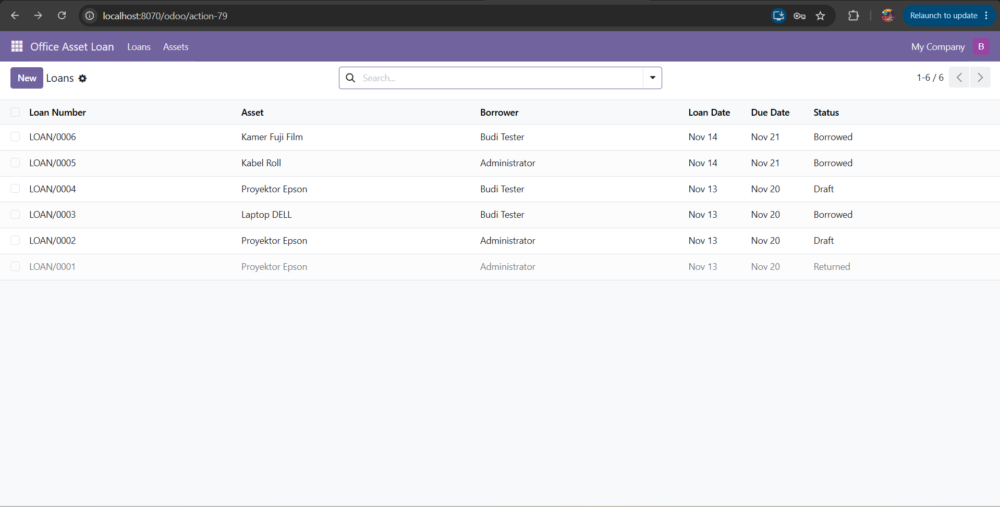
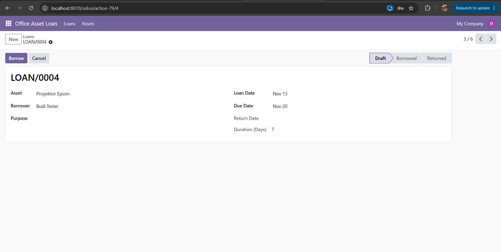
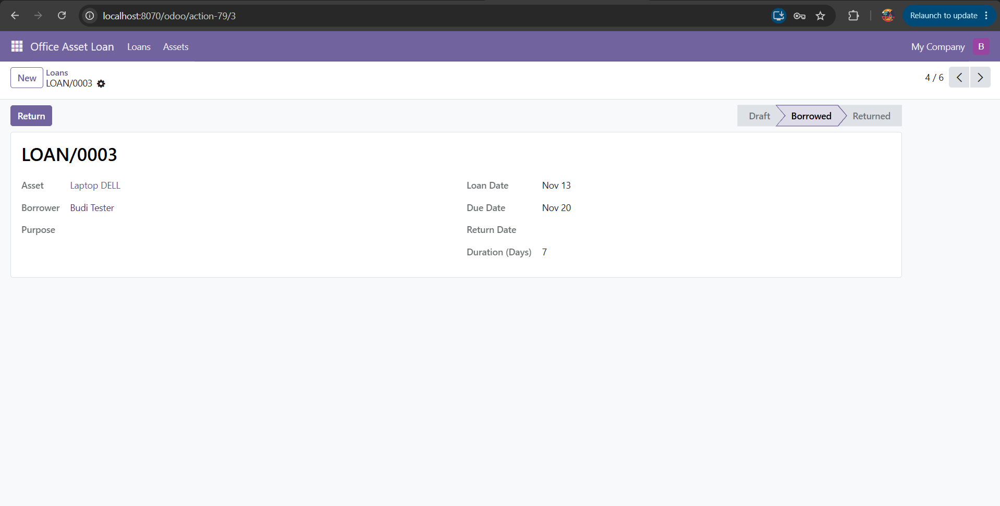
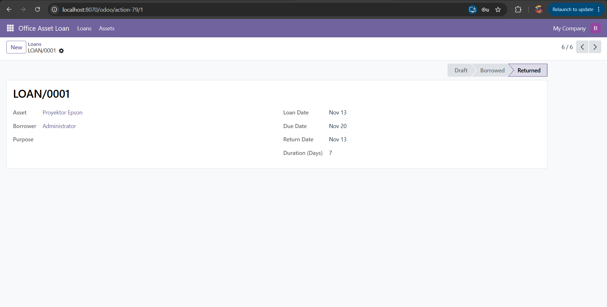
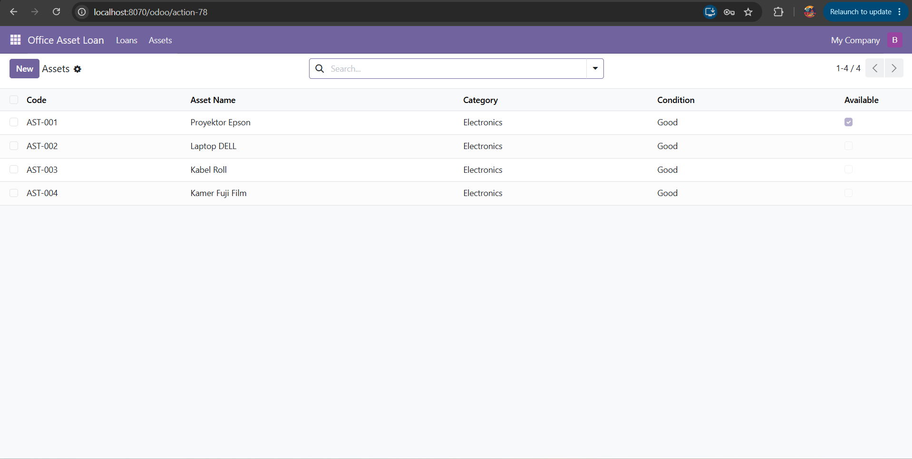
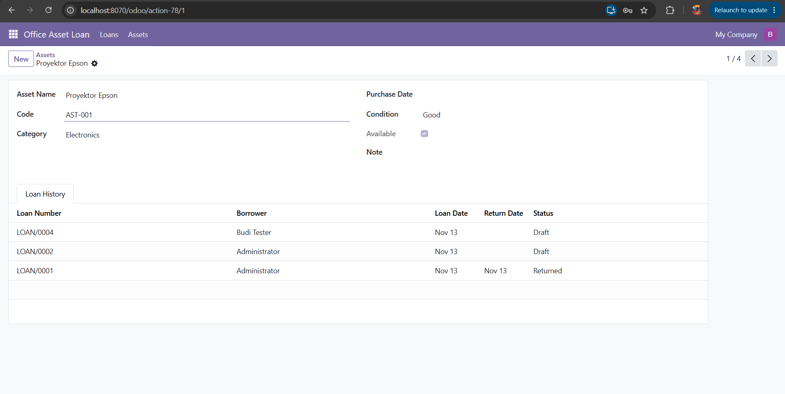
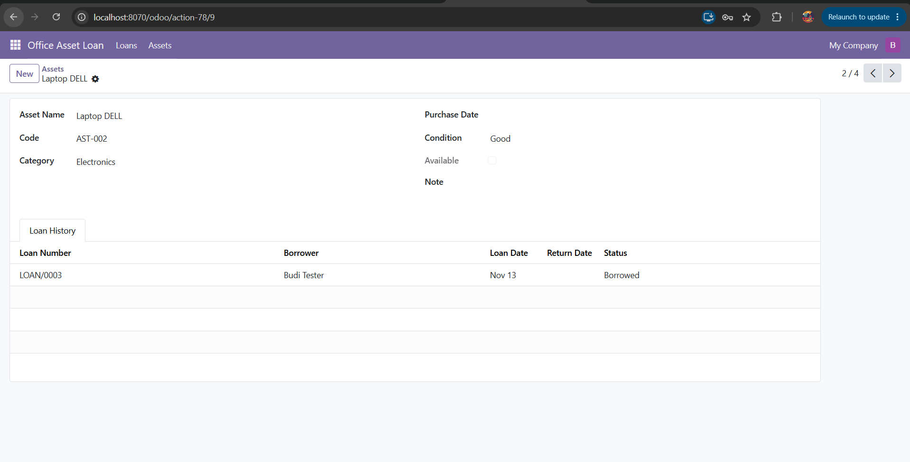
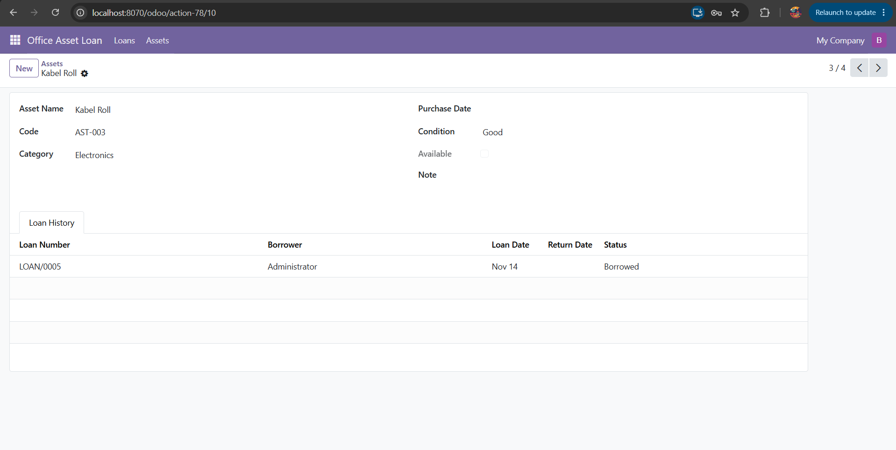
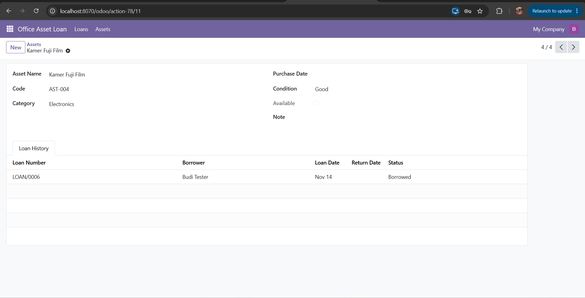

# Office Asset Loan

Modul custom Odoo untuk mencatat aset kantor (proyektor, laptop, kabel, kamera, dll.) dan siapa yang meminjamnya. Dibuat untuk tugas **Jidoka Odoo Bootcamp Batch #10 (Basic)**.

- **Versi Odoo:** Community Edition (CE) 19.0
- **Penulis:** Maulana Ash Shddiq
- **Lisensi:** LGPL-3

## Fitur

- **Aset** (`office.asset`): nama, kode unik, kategori, tanggal pembelian, kondisi (Good, Fair, Damaged), dan catatan. Kolom *Available* otomatis tercentang selama aset tidak sedang dipinjam. Tab *Loan History* di form aset menampilkan seluruh riwayat peminjamannya.
- **Peminjaman** (`office.asset.loan`): nomor otomatis (LOAN/0001, LOAN/0002, dst.), aset, peminjam (otomatis pengguna yang login), tanggal pinjam, jatuh tempo, tanggal kembali, keperluan, dan lama pinjam dalam hari.
- **Alur status:** Draft, lalu Borrowed, lalu Returned, atau Draft lalu Cancelled, dengan tombol **Borrow**, **Return**, dan **Cancel**.
- **Peminjaman lewat jatuh tempo** ditandai merah di daftar, dan peminjaman Returned atau Cancelled ditampilkan redup.
- **Pencarian:** filter aset *Available*, filter peminjaman *Borrowed*, dan pengelompokan berdasarkan kategori, peminjam, atau status.
- **Hak akses:** user internal bisa melihat menu, membuat, dan mengubah aset serta peminjaman.

## Aturan Bisnis

| Kode | Aturan | Implementasi |
|------|--------|--------------|
| BR-1 | Kode aset tidak boleh sama | `models.Constraint('UNIQUE(code)')` |
| BR-2 | Jatuh tempo tidak boleh lebih awal dari tanggal pinjam | `@api.constrains` + `ValidationError` |
| BR-3 | Nomor peminjaman otomatis `LOAN/0001`, dst. | override `create()` + `ir.sequence` |
| BR-4 | Borrow hanya dari Draft; ditolak jika aset sedang dipinjam atau rusak | method `action_borrow` + `UserError` |
| BR-5 | Return hanya dari Borrowed; tanggal kembali diisi hari ini | method `action_return` |
| BR-6 | Cancel hanya dari Draft | method `action_cancel` |
| BR-7 | Peminjaman Borrowed atau Returned tidak boleh dihapus | `@api.ondelete(at_uninstall=False)` |
| BR-8 | Jatuh tempo otomatis tanggal pinjam + 7 hari | `@api.onchange` |

## Instalasi

1. Clone repo ini:

   ```bash
   git clone https://github.com/USERNAME/office-asset-loan.git
   ```

2. Tambahkan folder hasil clone (folder yang berisi `office_asset_loan/`) ke `addons_path` di file konfigurasi Odoo (`odoo.conf`), lalu restart Odoo.

3. Pasang modul. Pilih salah satu:

   - **Lewat perintah:**

     ```bash
     python odoo-bin -c odoo.conf -d nama_database -i office_asset_loan
     ```

   - **Lewat tampilan Odoo:** aktifkan *Developer Mode*, buka **Apps**, klik **Update Apps List**, cari **Office Asset Loan**, lalu klik **Install**.

4. Buka aplikasi **Office Asset Loan** dari menu utama. Menu **Loans** dan **Assets** akan tersedia.

## Screenshot

### Peminjaman

Daftar peminjaman (peminjaman Returned tampil redup):



Peminjaman berstatus Draft (tombol Borrow dan Cancel tersedia):




Peminjaman berstatus Borrowed (form terkunci, hanya tombol Return):




Peminjaman berstatus Returned (tanggal kembali terisi):



### Aset

Daftar aset (kolom Available):



Form aset dengan tab Loan History:









## Struktur Modul

```
office-asset-loan/
├── README.md
├── screenshots/
└── office_asset_loan/
    ├── __init__.py
    ├── __manifest__.py
    ├── data/
    │   └── office_asset_loan_sequence.xml
    ├── models/
    │   ├── __init__.py
    │   ├── office_asset.py
    │   └── office_asset_loan.py
    ├── security/
    │   └── ir.model.access.csv
    └── views/
        ├── office_asset_views.xml
        ├── office_asset_loan_views.xml
        └── office_asset_menus.xml
```

## Pengujian

Modul diuji pada database baru dengan 12 skenario uji dari tugas: pemasangan tanpa WARNING, pembuatan aset, penolakan kode kembar, nomor peminjaman otomatis, validasi tanggal, Borrow dan Return, penolakan peminjaman ganda dan aset rusak, penolakan hapus peminjaman Borrowed, tab Loan History, dan akses sebagai user internal biasa (bukan Administrator).